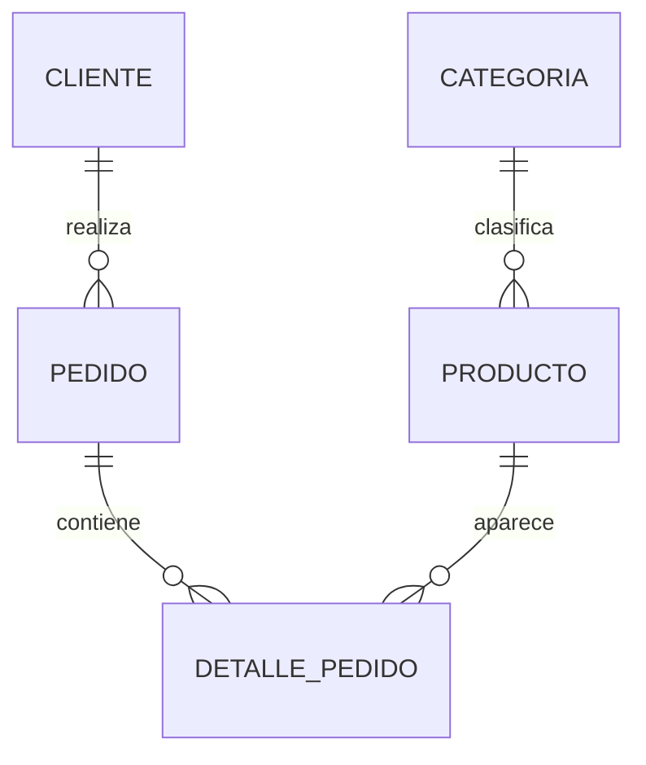

# Tienda: datos y reglas del laboratorio

El caso es ficticio. Los importes son unidades monetarias de ejemplo, sin impuestos ni descuentos implícitos. No representan tarifas reales. Los pedidos tienen fechas fijas en UTC; configurar UTC hace reproducibles los reportes temporales.

## Modelo y límites

Cada producto necesita categoría y cada pedido cliente. Categorías y clientes pueden existir sin registros hijos. Un pedido CREADO puede no tener líneas. La FK garantiza que una línea apunte a un pedido existente, **no** que todo pedido tenga al menos una línea. La regla «solo se paga un pedido con detalles» necesita una operación transaccional adicional (el proyecto aplica este mismo principio a la disponibilidad de ejemplares).

Una línea usa PK `(pedido_id,producto_id)`: en este modelo el mismo producto aparece una sola vez por pedido y acumula su cantidad. Si el negocio admite varias líneas del mismo producto con promociones distintas, necesitaría otra clave, por ejemplo `(pedido_id,numero_linea)`.

## Diccionario

| Tabla | Clave | Datos y decisiones |
|---|---|---|
| categoria | id | nombre único y no vacío; unicidad de texto distingue mayúsculas según comparación |
| producto | id | FK categoría obligatoria; precio decimal positivo (se rechaza NaN); descripción opcional; activo permite conservar historial |
| cliente | id | correo único, obligatorio y no vacío; teléfono opcional como texto (conserva prefijos/ceros) |
| pedido | id | FK cliente obligatoria; fecha `timestamptz`; estado CREADO/PAGADO/CANCELADO |
| detalle_pedido | pedido_id + producto_id | FK a ambos; cantidad entera positiva; precio_unitario histórico positivo (se rechaza NaN) |

`GENERATED ALWAYS AS IDENTITY` genera valores, pero la PK es la que exige unicidad. Las secuencias pueden dejar huecos tras fallos o rollback. No utilices IDs para contar ventas ni prometas numeración sin huecos.

`timestamptz` representa un instante, almacenado con referencia UTC y presentado según la zona de la sesión; no conserva el nombre original de la zona ingresada. El correo tiene una regla didáctica de unicidad exacta; no se afirma que el CHECK valide existencia de la cuenta ni todos los formatos de correo. Reglas más complejas deben explicitarse.

## Datos de referencia

| Producto id | Nombre | Categoría | Precio actual | Activo | Descripción |
|---:|---|---|---:|---|---|
| 1 | Algoritmos | Libros | 80 | sí | Libro de algoritmos |
| 2 | Bases de datos | Libros | 90 | sí | NULL |
| 3 | Teclado | Tecnología | 120 | sí | Teclado USB |
| 4 | Mouse | Tecnología | 90 | sí | NULL |
| 5 | Lámpara | Hogar | 50 | no | Lámpara de escritorio |

Deportes (id 4) no tiene productos. Los clientes son Ana (1), Luis (2), Sara (3) y Tomás (4). Sara no tiene pedidos. Luis y Sara no registran teléfono (NULL). Que falte teléfono no equivale a teléfono de longitud cero.

| Pedido | Cliente | Estado | Líneas | Total histórico |
|---:|---|---|---:|---:|
| 1 | Ana | PAGADO | 2 | 320.00 |
| 2 | Luis | CREADO | 1 | 90.00 |
| 3 | Ana | PAGADO | 1 | 150.00 |
| 4 | Luis | CREADO | 0 | 0.00 |
| 5 | Tomás | CANCELADO | 1 | 450.00 |

El pedido 3 vendió dos libros Algoritmos a 75 cada uno. Multiplicar por el precio actual 80 produciría 160 y alteraría la historia. Usa `detalle_pedido.precio_unitario`.

## Resultados para comprobar

| Pregunta | Resultado |
|---|---|
| Conteos categoría/producto/cliente/pedido/detalle | 4 / 5 / 4 / 5 / 5 |
| Productos activos | 4 |
| Suma y promedio de precios actuales (todos) | 430.00 / 86.00 |
| Unidades de todas las líneas | 11 |
| Valor de todas las líneas | 1010.00 |
| Ventas pagadas (solo PAGADO) | 470.00 |
| Unidades pagadas | 5 |
| Clientes sin pedidos | Sara (3) |
| Pedidos sin líneas | 4 |
| Productos por categoría | Libros 2; Tecnología 2; Hogar 1; Deportes 0 |

Un total de pedido cero por falta de líneas usa `COALESCE` como regla de reporte. No significa que cualquier precio desconocido deba convertirse en cero. Estos conteos corresponden a la carga inicial; prácticas persistentes o proyectos separados pueden tener otros datos.

## Política referencial

Pedido → detalle usa CASCADE: la línea carece de sentido sin su pedido. Cliente → pedido, categoría → producto y producto → detalle usan NO ACTION para proteger referencias. Eso no autoriza borrar ventas pagadas: es una decisión adicional del negocio. El proyecto impide esa operación mediante permisos y operaciones controladas.

[Entorno](ENTORNO.md) · [Índice](../README.md)
