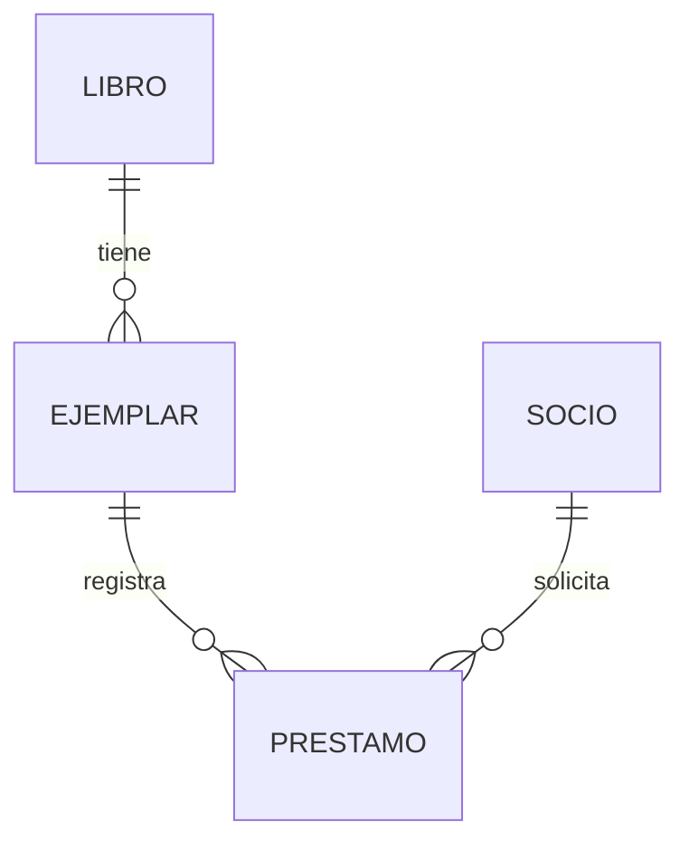

# Proyecto de referencia: biblioteca

Estudia este proyecto después de intentar el tuyo. Es una base de datos, sin aplicación web. Usa datos ficticios. Los identificadores ISBN son códigos de ejemplo; su CHECK solo exige texto no vacío y unicidad, no valida el dígito de control.

## Problema y reglas

Una biblioteca registra ediciones, copias físicas, socios y préstamos. Preguntas: ¿qué ejemplares se pueden prestar?, ¿qué socios tienen historial?, ¿qué está vencido a una fecha de corte?, ¿cuántas copias y préstamos tiene cada título?

Reglas implementadas:

1. Un ejemplar pertenece a una edición (libro en este alcance).
2. Código de ejemplar e ISBN son únicos y obligatorios.
3. Socio necesita nombre y correo no vacíos; correo único exacto.
4. Cada préstamo pertenece a un socio y un ejemplar existentes.
5. Vencimiento debe ser posterior al inicio.
6. Devolución, si existe, no puede preceder al inicio.
7. No hay dos préstamos **abiertos** para el mismo ejemplar (índice único parcial).
8. Un ejemplar inactivo no se presta mediante la operación autorizada.
9. Un nuevo préstamo empieza al cerrar el historial anterior o después; no se insertan préstamos retrospectivos entre otros mediante esta operación.
10. El lector solo accede a una vista sin correo.
11. El operador presta/devuelve mediante funciones, sin DML directo sobre tablas.
12. Una devolución repetida con la misma fecha es idempotente; con otra fecha se rechaza.

La carga inicial se ejecuta como propietario y debe respetar estas reglas. Los permisos y funciones controlan operaciones del usuario; un propietario o superusuario puede saltarse esas capas. Este proyecto no incluye reservas, multas, autores, préstamos de varios ejemplares en una sola operación ni auditoría de identidades individuales. Son ampliaciones que requieren reglas nuevas.

## Modelo



| Tabla | Clave y atributos | Decisión |
|---|---|---|
| libro | id PK; isbn UNIQUE; titulo | edición, no copia física |
| ejemplar | id PK; codigo UNIQUE; libro_id FK; activo | baja lógica conserva historial |
| socio | id PK; correo UNIQUE; nombre | puede existir sin préstamos |
| prestamo | id PK; socio_id/ejemplar_id FK; inicio/vence_en/devuelto_en | historial, devolución opcional |

## Normalización razonada

Una hoja préstamo(id,socio_id,socio_nombre,correo,ejemplar_id,codigo,libro_id,isbn,titulo,inicio,vence_en,devuelto_en) repite socio y título. Dependencias: socio_id→nombre,correo; ejemplar_id→codigo,libro_id,activo; libro_id→isbn,titulo; prestamo_id→socio_id,ejemplar_id,fechas. Bajo las reglas descritas existen también claves alternativas correo, codigo e isbn en sus respectivas entidades. Separar esos hechos elimina anomalías de actualizar un título en muchos préstamos o perder una edición al borrar su último préstamo. La reconstrucción une por PK/FK y conserva una fila por préstamo, no un producto cartesiano. Las claves y dependencias permiten justificar 3FN en este alcance; no se afirma que cualquier tabla con id esté automáticamente normalizada.

## Reconstruir paso a paso

1. Sigue [ENTORNO.md](../docs/ENTORNO.md) y crea una base vacía `curso_biblioteca` cuyo dueño sea estudiante. Separa este proyecto de la tienda de prácticas.
2. Desde la raíz del repositorio ejecuta cada comando, por separado:

```text
psql -X -h localhost -U estudiante -d curso_biblioteca -v ON_ERROR_STOP=1 -f proyecto-biblioteca/01_schema.sql
psql -X -h localhost -U estudiante -d curso_biblioteca -v ON_ERROR_STOP=1 -f proyecto-biblioteca/02_datos.sql
psql -X -h localhost -U estudiante -d curso_biblioteca -v ON_ERROR_STOP=1 -f proyecto-biblioteca/03_consultas.sql
psql -X -h localhost -U estudiante -d curso_biblioteca -v ON_ERROR_STOP=1 -f proyecto-biblioteca/04_operaciones.sql
psql -X -h localhost -U estudiante -d curso_biblioteca -v ON_ERROR_STOP=1 -f proyecto-biblioteca/05_indices.sql
psql -X -h localhost -U estudiante -d curso_biblioteca -v ON_ERROR_STOP=1 -f proyecto-biblioteca/07_pruebas.sql
```

3. El script 06 requiere un administrador porque crea roles. Conecta como administrador a **curso_biblioteca** y ejecútalo. Es una demostración con ROLLBACK: no deja roles ni préstamos nuevos. Para conservar identidades, crea roles propios, concede los mismos permisos y membresías a LOGIN individuales; no conviertas al operador en dueño de tablas.
4. Referencia inicial: 3 socios, 3 libros, 4 ejemplares y 3 préstamos; 1 abierto (id 2); ejemplares 1 y 3 disponibles; Sara sin historial; Redes sin copias.

## Operaciones y concurrencia

`prestar` bloquea el ejemplar con FOR UPDATE antes de comprobar disponibilidad e insertar. Dos conexiones que solicitan la misma copia se coordinan mediante esa fila. Con READ COMMITTED, la segunda espera y luego ve el préstamo confirmado; el índice parcial añade una garantía declarativa. Con aislamientos más fuertes puede ser necesario reintentar la transacción completa por 40001.

`devolver` identifica la copia, bloquea ejemplar y después préstamo (mismo orden inicial), verifica fechas y registra la devolución. Una operación se ejecuta dentro de la transacción del llamador: la función no hace COMMIT por su cuenta. Si una etapa falla, se revierte la sentencia; usa BEGIN/COMMIT o ROLLBACK para agrupar una operación mayor.

Para practicar sin conservar el préstamo:

```sql
BEGIN;
SELECT biblioteca.prestar(1,1,'2026-01-10 10:00+00','2026-01-20 10:00+00');
SELECT * FROM biblioteca.prestamos_abiertos ORDER BY prestamo_id;
ROLLBACK;
```

Anota el identificador realmente devuelto en tu operación; después de pruebas las secuencias pueden tener huecos. No uses un id supuesto para devolver un préstamo.

## Permisos y SECURITY DEFINER

Las funciones necesitan escribir aunque el operador no tenga acceso directo a tablas. SECURITY DEFINER ejecuta con privilegios del dueño. Se fijó search_path a pg_catalog,pg_temp, se cualificaron tablas y se retiró EXECUTE de PUBLIC en la misma transacción que crea las funciones. No hay SQL dinámico con entradas del usuario. El esquema no concede CREATE a PUBLIC.

Es una herramienta que exige un dueño controlado y revisar el código. No otorgues membresía del rol propietario al operador ni permitas que usuarios sin confianza reemplacen objetos. Comprueba que CREATE/INSERT/UPDATE/DELETE directos están denegados; un rol que obtiene permisos por otra membresía puede tener más acceso que este ejemplo. La función no vincula p_socio a una identidad autenticada: el operador de biblioteca puede prestar a distintos socios por requisito.

## Rendimiento, calidad y recuperación

El índice parcial implementa una regla; el índice socio+inicio corresponde al historial ordenado. Con tres préstamos PostgreSQL puede preferir Seq Scan: no declares mejora sin volumen, estadísticas y planes. Usa el método de las unidades 25/26 con una copia sintética, y conserva resultados y costos de escritura.

Para un lote externo de socios, adapta staging de las unidades 28/30, confirma la regla de normalización del correo y conserva rechazadas. No insertes un CSV directamente sobre la tabla final ni publiques datos personales.

Adapta [RESTAURACION.md](../unidad29-backup/RESTAURACION.md) al origen curso_biblioteca y destino curso_biblioteca_restaurada. Además de conteos, comprueba la vista, el índice parcial, las funciones y que se impida otro préstamo abierto del ejemplar 2. La restauración con --no-privileges omite también las revocaciones de EXECUTE para PUBLIC: las funciones recuperan su permiso predeterminado. **Antes de habilitar usuarios**, ejecuta [08_permisos_base.sql](08_permisos_base.sql) como nuevo propietario o administrador, después configura roles/membresías y verifica accesos con 06_roles.sql. No basta con recrear los roles: se deben restaurar también las revocaciones base.

```text
psql -X -h localhost -U estudiante -d curso_biblioteca_restaurada -v ON_ERROR_STOP=1 -f proyecto-biblioteca/08_permisos_base.sql
```

Este paso restaura la política base del proyecto; la identidad administrativa ejecuta luego la demostración 06. Una recuperación real debería hacerse en un destino sin accesos de usuarios hasta completar esas comprobaciones.

## Ampliación a entregar

Agrega reservas de ejemplares o historial de multas. Define primero diez reglas, modelo y límites. Incluye datos de frontera, consultas, una operación transaccional y pruebas de concurrencia y restauración. No copies el proyecto cambiando nombres: justifica qué relaciones y dependencias cambiaron.

[Proyecto final](../unidad32-proyecto-final/README.md) · [Verificación](../docs/VERIFICACION.md)
